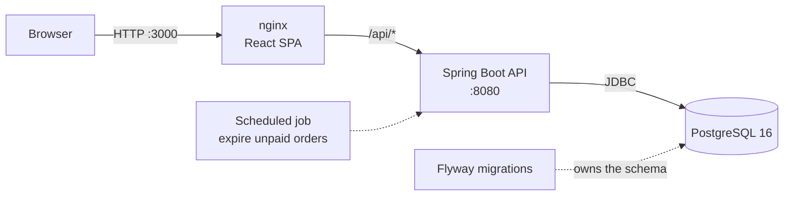

# EventHub

[](https://github.com/BarbosaMatheu/event-hub/actions/workflows/ci.yml)


A full-stack **event ticketing platform**: people browse and search events, buy tickets, and pay
for them; administrators manage the catalogue and follow sales on a dashboard.

The interesting part is not the CRUD, it is everything around it: **concurrent buyers can never
oversell an event**, unpaid reservations **expire and give their tickets back**, the schema is
**versioned with Flyway**, security is **stateless JWT with role-based access**, and the whole
thing is verified by unit tests, **integration tests against a real PostgreSQL (Testcontainers)**
and a CI pipeline.

> Built by [Matheus Barbosa](https://github.com/BarbosaMatheu) as a portfolio project.
> The payment step is simulated (see [Limitations](#limitations-and-next-steps)).

---

## Run it in one command

Requirements: **Docker** (with Compose).

```bash
git clone https://github.com/BarbosaMatheu/event-hub.git
cd event-hub
docker compose up --build
```

| What | Where |
| --- | --- |
| Web app | http://localhost:3000 |
| API + Swagger UI | http://localhost:8080/swagger-ui/index.html |
| Health check | http://localhost:8080/actuator/health |

The first start loads a demo catalogue. A demo administrator is created for you:
**`admin` / `Admin@12345`** (local demo defaults, see `.env.example` to change them).
Anyone can register a regular account from the UI.

> Port 5432 busy? Stop your local PostgreSQL, the compose database binds `127.0.0.1:5432`.

---

## Features

**For visitors and customers**
- Search events by text, category, price range and date range; hide sold-out events; sort; paginate.
  Filters live in the URL, so a search can be bookmarked and shared.
- Event page with live availability ("few left", "sold out") and a ticket selector.
- Sign up / log in. Buy tickets (up to 10 per event). The order starts as *awaiting payment* and
  **holds the tickets for 30 minutes** with a live countdown; pay or cancel from *My orders*.
- Responsive layout (mobile menu, stacked filters), dark mode, accessible forms and dialogs.

**For administrators**
- Dashboard: revenue, tickets sold, order counts by status, best-selling events.
- Create, edit and delete events and categories (with the safety rules listed below).
- See every order and mark it paid or cancel it.

**Platform behaviour**
- Overselling is impossible, even with simultaneous buyers (proved by a concurrency test).
- Abandoned reservations expire automatically and release their tickets.
- Prices are always decided by the server; an order keeps the price it was bought at.

---

## Architecture



**Backend** (`backend/`): layered, with strict boundaries.

```
controllers   HTTP only: parse/validate the request, return DTOs        (/api/v1/...)
services      business rules, transactions, locking
models        JPA entities with their own invariants (Event.reserve, Order.updateStatus...)
repositories  Spring Data JPA (+ Specifications for the dynamic search)
dtos          request/response records: entities are never serialised
config        security (JWT filter, CORS, 401/403 handlers), OpenAPI, request-id logging
jobs          scheduled expiration of unpaid orders
```

**Frontend** (`frontend/`): React 18 + TypeScript + Vite + Tailwind CSS, no state-management
library on purpose: a small `useAsync` hook, an auth context and URL-driven state are enough.
Admin screens are code-split and only downloaded by administrators.

### Tech stack

| Area | Choices |
| --- | --- |
| Backend | Java 21, Spring Boot 4 (Web MVC, Data JPA, Security, Validation, Actuator), Hibernate |
| Database | PostgreSQL 16, **Flyway** (9 migrations), CHECK constraints, row-level locking |
| Auth | JWT (HS256) + BCrypt, stateless, role-based (`ADMIN` / `USER`) |
| API docs | springdoc OpenAPI / Swagger UI |
| Frontend | React 18, TypeScript (strict), Vite, React Router, Tailwind CSS |
| Quality | JUnit 5, Mockito, **Testcontainers**, Vitest, JaCoCo, GitHub Actions, Dependabot |
| Delivery | Multi-stage Dockerfiles (non-root user, healthchecks), Docker Compose, nginx |

---

## Engineering decisions

**1. No overselling: pessimistic locking, in a fixed order.**
Buying tickets takes `SELECT ... FOR UPDATE` on the event rows before checking and decrementing
stock. Events are always locked in ascending id order (a `TreeMap` also merges duplicate lines), so two
orders touching the same events can never deadlock. A database `CHECK (tickets_sold <= capacity)`
backs the application logic up. *Trade-off:* it serialises buyers of the same event, which is
exactly right for scarce stock; optimistic retries or Redis would add complexity without benefit
at this scale.

**2. The domain model protects its own invariants.**
`Event.reserve()` / `release()` / `changeCapacity()` are the only ways to change stock;
`Order.updateStatus()` is a tiny state machine (`PENDING → COMPLETED | CANCELLED`, nothing else).
Services orchestrate; they do not re-implement rules.

**3. Reservations expire.**
A scheduled job cancels `PENDING` orders older than the TTL and returns their tickets. Every status
change locks the order row first, so *pay*, *cancel* and *expire* can never race each other and
tickets are never released twice. The server sends `expiresInSeconds` with each order, so the UI
countdown does not depend on clock or timezone agreement.

**4. Schema is code: Flyway + `ddl-auto=validate`.**
Hibernate never creates or alters tables; it only checks that the entities match what the
migrations built. Applied migrations are immutable, changes are new `V*` files. Integration tests
run the real migrations on a real PostgreSQL, so a mismatch fails the build.

**5. Server-authoritative data.**
The client sends *what* and *how many*; prices, totals and timestamps are computed on the server,
and the unit price is snapshotted into the order item.

**6. One error contract.**
Every failure, including 401/403 produced inside the security filter chain, returns the same JSON:
`{timestamp, status, error, message, path, violations?}` with field-level `violations` for
validation errors. Unknown sort fields, malformed JSON and bad parameters are clean `400`s, never
`500`s. A `X-Request-Id` header (generated or propagated) ties a user's report to the server logs.

**7. Security by default.**
- Public registration **always creates a regular user**; administrators only come from the bootstrap
  configuration. (There is a test for the privilege-escalation attempt.)
- Login errors are generic (no user enumeration) and failed logins are throttled per login+IP (429 + `Retry-After`).
- The JWT secret has **no default** and must be ≥ 32 characters: the app refuses to start otherwise.
- Users are re-loaded on every request, so a deleted account loses access immediately.
- Other users' orders look exactly like orders that do not exist (404).

**8. Time handled explicitly.**
All "now" logic goes through an injected `Clock` (deterministic tests, configurable zone). Event
start times are venue-local wall-clock times; order timestamps are absolute instants.

**9. Query design.**
The search is built with JPA Specifications, adding only the filters that were sent. User text is
escaped for `LIKE`. Sorting is whitelisted (and tie-broken by id so pages are stable). Open-in-view is off,
services map entities to DTOs inside the transaction, and batch fetching removes N+1 selects.

**10. Plain pagination envelope.**
List endpoints return `{content, page, size, totalElements, totalPages, ...}` instead of HAL/HATEOAS:
simpler for a SPA to consume and independent of framework internals.

---

## API at a glance

Base path `/api/v1`. Full, interactive documentation lives in Swagger UI.

| Method | Path | Access | Purpose |
| --- | --- | --- | --- |
| POST | `/auth/register` | public | Create a regular account |
| POST | `/auth/login` | public | Get a JWT |
| GET | `/auth/me` | user | Current user |
| GET | `/events` | public | Search/filter/sort/paginate events |
| GET | `/events/{id}` | public | Event details with availability |
| POST/PUT/DELETE | `/events[/{id}]` | admin | Manage events |
| GET | `/categories[/{id}]` | public | List/read categories |
| POST/PUT/DELETE | `/categories[/{id}]` | admin | Manage categories |
| POST | `/orders` | user | Buy tickets (reserves them) |
| GET | `/orders`, `/orders/{id}` | user | My orders (admins can read any) |
| POST | `/orders/{id}/pay` | owner | Pay (simulated) |
| POST | `/orders/{id}/cancel` | owner/admin | Cancel and release tickets |
| PUT | `/orders/{id}/status` | admin | Change status |
| GET | `/admin/stats`, `/admin/orders` | admin | Dashboard data, all orders |

Event search parameters: `search`, `categoryId`, `minPrice`, `maxPrice`, `from`, `to`
(dates, `yyyy-MM-dd`), `onlyAvailable`, `includePast`, `page`, `size`, `sort`
(`startsAt|price|title|createdAt`, e.g. `sort=price,desc`).

---

## Testing

| Layer | What it proves | Tooling |
| --- | --- | --- |
| Domain & service unit tests | stock rules, state machine, locking order, ownership, expiry, rate limiter, JWT | JUnit 5, Mockito |
| Integration tests | Flyway migrations + JPA mappings on a **real PostgreSQL**, DB-level constraints | Testcontainers |
| API tests | the real HTTP stack end to end: auth, permissions, validation, search, purchase flow, **12 concurrent buyers for 5 tickets**, order expiry | Testcontainers + JDK `HttpClient` |
| Frontend unit tests | formatting, validation, JWT parsing, pagination helpers | Vitest |

The backend has **134** test methods and the frontend **29** test cases. CI also type-checks the
frontend (TypeScript strict), builds both apps, builds the Docker images and uploads the
JaCoCo coverage report.

```bash
# backend (the integration tests need Docker running)
cd backend && ./mvnw verify          # coverage: target/site/jacoco/index.html

# frontend
cd frontend && npm install && npm test && npm run typecheck
```

---

## Local development (without Docker for the apps)

```bash
# 1. database only
docker compose up -d postgres-db

# 2. backend  (profile "dev": demo data + admin/Admin@12345, verbose logs)
cd backend
export SPRING_DATASOURCE_PASSWORD=postgrespassword
export JWT_SECRET=a-local-secret-with-at-least-32-characters
./mvnw spring-boot:run               # Windows PowerShell: $env:VAR="..." ; .\mvnw.cmd spring-boot:run

# 3. frontend (proxies /api to :8080)
cd frontend && npm install && npm run dev      # http://localhost:5173
```

Configuration is environment-driven; see `backend/src/main/resources/application*.properties`
and `.env.example`. Profiles: `dev` (default locally) and `prod` (used by Docker Compose).

---

## Project layout

```
.
├── backend/            Spring Boot API (Maven)
│   ├── src/main/java/.../{config,controllers,services,models,repositories,dtos,exceptions,jobs,utils}
│   ├── src/main/resources/db/migration/   Flyway V1..V9
│   └── src/test/java/...                  unit, integration and API tests
├── frontend/           React + TypeScript SPA (Vite, Tailwind), nginx Dockerfile
├── docker-compose.yml  db + api + web
├── .github/            CI workflow, Dependabot
└── docs/               place for screenshots and diagrams
```

---

## Limitations and next steps

Honest list of what this project deliberately does not do (yet):

- **Payments are simulated.** A real integration (e.g. Stripe) would add a payment intent and a
  webhook that completes the order.
- **Login throttling is in-memory**, correct for one instance. Several instances would share the counters in Redis.
- **The token is kept in `localStorage`** (simple, but readable by any XSS). A production system
  handling money would use an httpOnly cookie plus CSRF protection and refresh tokens.
- No e-mail confirmations, no image upload (events take an image URL), one event per checkout in the UI
  (the API already supports several).
- No browser end-to-end tests (Playwright) and no metrics/tracing dashboards yet.
- Deployment: the images are production-shaped; the next step is running them on AWS (ECS/RDS) with the same pipeline.
